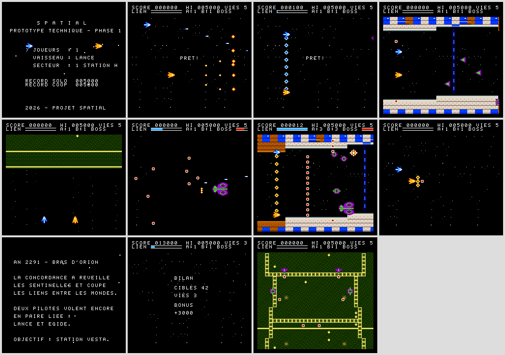

# Projet SPATIAL — Shoot'em up spatial coopératif pour NES

Jeu original pour Nintendo Entertainment System d'origine, réalisé selon le
[cahier des charges maître](Cdc%20spatial.md).

> **État : Phase 1 (prototype technique) réalisée et testée en émulation.**
> Les phases 2 à 5 (tranche verticale, campagne complète, finition, cartouche)
> restent à faire. Aucun test sur matériel réel n'a été effectué : voir
> [docs/CONFORMITE.md](docs/CONFORMITE.md) pour l'état exact de chaque exigence.



## Contenu du prototype

- ROM NES MMC3 (TKROM) de 96 Kio : `dist/spatial-proto-phase1.nes`
- Coopération à 2 joueurs simultanés (2 manettes) **et** mode solo complet
- Deux vaisseaux différents : **LANCE** (intercepteur rapide, tir concentré)
  et **ÉGIDE** (vaisseau lourd, tir en éventail), 3 niveaux d'arme chacun
- Capacités propres : **Surcharge** (LANCE, esquive rapide) et **Bouclier
  frontal** (ÉGIDE, absorbe 4 projectiles)
- Collisions physiques entre joueurs, sans dégâts ni blocage
- **Salve synchronisée** : les deux pilotes appuient sur A ensemble
- Séquences narratives entre les secteurs, écran de bilan de fin de secteur
- Ressource coopérative **LIEN** et trois pouvoirs : **Faisceau de Liaison**
  (attaque combinée dépendant du placement des deux vaisseaux),
  **Transfert d'énergie** (ramène un partenaire sans vie), **Nova** (solo)
- Secteur 1 en **défilement horizontal** (3 palettes de décor, conteneurs
  destructibles), secteur 2 en **défilement vertical**,
  HUD fixe par séparation d'écran (IRQ de ligne MMC3)
- 4 familles d'ennemis (drones, chasseurs, tourelles, kamikazes), tirs visés
  sur 16 directions, mini-boss à 2 phases
- Moteur audio sur les 5 canaux (2 pulse, triangle, bruit, DPCM),
  5 musiques originales (écoute : `docs/audio/`), instruments à
  enveloppes, 15 effets sonores
- Point de reprise à mi-secteur et 3 crédits « CONTINUER »
- Sauvegarde des records sur PRG-RAM à pile (double copie + somme de contrôle)
- Détection NTSC/PAL et compensation de cadence 6/5 en 50 Hz

## Compiler

Prérequis : `cc65` (ca65/ld65 ≥ 2.18), Python 3, et Node.js ≥ 18 pour les tests.

```sh
make          # build/spatial.nes (+ carte mémoire et symboles)
make dist     # copie la ROM dans dist/
make test     # suite de tests automatisés en émulation (jsnes)
```

La compilation est reproductible (test T22 : deux constructions identiques
octet pour octet).

## Commandes

| Action | Manette |
|---|---|
| Déplacement 8 directions | Croix |
| Tir (maintenu) | A |
| Capacité du vaisseau / pouvoir coopératif (jauge LIEN pleine) | B |
| Pause | START |
| Menu : ligne / valeur / départ | Haut-Bas / Gauche-Droite / START |

En coopération, la manette 1 pilote LANCE et la manette 2 ÉGIDE.

## Organisation

| Dossier | Contenu |
|---|---|
| `src/` | Code 6502 (ca65), un fichier par système |
| `assets/` | Sources graphiques (pixel art texte), partitions |
| `tools/gen_assets.py` | Conversion des ressources (CHR, cartes, musique, DPCM) |
| `cfg/mmc3.cfg` | Configuration de l'éditeur de liens (bancs MMC3) |
| `tests/` | Banc de test jsnes et suite automatisée |
| `docs/` | Conception, architecture, budgets, journal, résultats |

## Documentation

- [Conformité au cahier des charges](docs/CONFORMITE.md)
- [Game Design Document (ébauche)](docs/GDD.md)
- [Architecture logicielle et technique](docs/ARCHITECTURE.md)
- [Cartographie mémoire](docs/MEMOIRE.md)
- [Budgets de performance](docs/BUDGETS.md)
- [Résultats des tests](docs/RESULTATS_TESTS.md)
- [Journal de production](docs/JOURNAL.md)
- [Risques](docs/RISQUES.md)
- [Manuel du joueur](docs/MANUEL.md)
